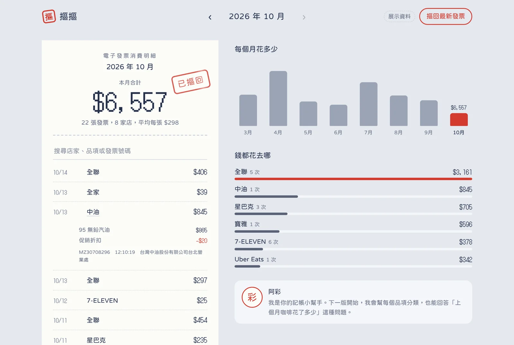
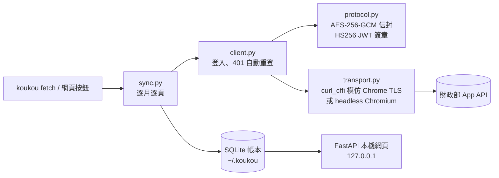

<div align="center">


# 摳摳 KouKou

**把散在各家銀行和發票載具裡的摳摳，一筆一筆摳回來。**<br>
*Dig your money data back out — and let AI tell you where it went.*

[](https://github.com/pengwho/koukou/actions/workflows/ci.yml)


[English](#english) · [中文](#中文)



</div>

## 中文

「摳摳」是台灣人講錢的口語。這個專案做三件事，剛好對上「摳」的三個意思：

| 摳 | 做什麼 |
| --- | --- |
| 摳摳＝錢 | 把手機條碼的電子發票（之後還有銀行帳戶）收進**你自己電腦上**的一本帳 |
| 摳＝挖出來 | 模擬官方 App 的協定把資料抓回來，不用一張一張手動匯出 |
| 摳＝省 | 讓 AI 助理**阿財**幫你分類、回答問題、找出可以省的地方（開發中） |

### 先看看長什麼樣子

不需要任何帳號，用虛構資料直接打開：

```bash
pip install git+https://github.com/pengwho/koukou
koukou demo
```

### 用你自己的發票

```bash
mkdir -p ~/.koukou && cp .env.example ~/.koukou/.env   # 填手機號碼與載具驗證碼
koukou fetch          # 抓最近 6 個月的發票與品項
koukou serve          # 打開介面；之後按「摳回最新發票」就能更新
```

`EINVOICE_PASSWORD` 是申請手機條碼時設定的**驗證碼**，不是簡訊一次性密碼。資料存在 `~/.koukou/koukou.sqlite3`，`koukou export` 可以匯出 CSV。

### 它怎麼運作



幾個值得一提的設計決定：

- **模擬手機 App，而不是爬網頁。** App 的 API 回傳結構化 JSON，有品項明細，也沒有圖形驗證碼。代價是要重現它的加密：登入資料用 AES-256-GCM 包成 `a|密文|b` 信封，查詢用登入拿到的密鑰簽 HS256 JWT。加密層有固定測試向量，跟參考實作逐位元比對。
- **兩種連線方式。** 財政部主機前面有 Cloudflare，一般的 HTTP client 會因為 TLS 指紋被擋。預設用 `curl_cffi` 模仿 Chrome 指紋（輕量，實測可通過）；被擋時可改用 `--transport browser` 在真的 Chromium 裡發請求，並在網路層拔掉查詢主機不接受的 `Origin` 標頭。
- **App 的 session 只有約 30 秒。** 抓半年資料一定會過期，所以遇到 `401` 就自動重新登入再重試。
- **增量同步。** 以發票號碼為主鍵覆寫；已經有品項的發票不會重抓，所以每天跑也很快。
- **展示模式走同一條路。** `koukou demo` 產生的假資料是 App API 的原始格式，經過跟真資料一樣的 `Store.save()`，所以它同時是寫入路徑的測試。

### 路線圖

- [x] 電子發票：表頭、品項、增量同步、CSV 匯出
- [x] 本機網頁介面與展示模式
- [ ] **阿財**：LLM 品項分類（含快取與準確率評估）
- [ ] **阿財**：用自然語言問帳本（text-to-SQL，唯讀與白名單防護）
- [ ] MCP server：讓 Claude 等 AI 直接查你的帳本
- [ ] 第一家銀行（Playwright）
- [ ] 打包成 macOS App，帳密改存 Keychain

### 注意

這是非官方工具，模擬官方 App 的做法不符合其使用條款；協定可能隨 App 改版失效。請只用在自己的帳號，資料只會存在你的電腦。

協定細節參考 [TedLin1993/all-set-tw](https://github.com/TedLin1993/all-set-tw)（MIT）。

---

## English

**KouKou** (摳摳, Taiwanese slang for *money*; 摳 also means *to dig out* and *to be thrifty*) is a local-first personal finance hub for Taiwan.

It pulls your e-invoices — every receipt tied to your mobile barcode carrier, down to line items — by speaking the official mobile app's API directly, stores them in a SQLite ledger on your own machine, and shows them in a small local web app. Bank accounts and an AI assistant, **A-Tsâi (阿財, "little fortune")**, are next.

```bash
pip install git+https://github.com/pengwho/koukou
koukou demo            # explore with generated data, no account needed
koukou fetch           # sync your own e-invoices (credentials in ~/.koukou/.env)
koukou serve           # open your ledger at http://127.0.0.1:8765
```

Engineering notes: the app protocol wraps credentials in an AES-256-GCM envelope and signs queries as HS256 JWTs (covered by fixed test vectors); Cloudflare's TLS fingerprinting is handled with `curl_cffi` Chrome impersonation, with a headless-Chromium fallback that strips the `Origin` header at the network layer; the ~30-second app session is renewed transparently on `401`; syncs are incremental and idempotent.

*Unofficial. Emulating the official app is against its terms of use and may break when the app updates. Use only with your own account.*

## License

MIT
