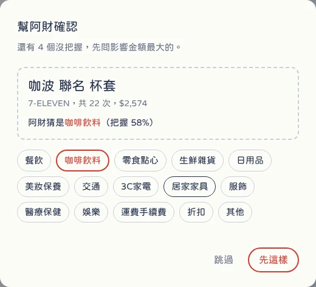
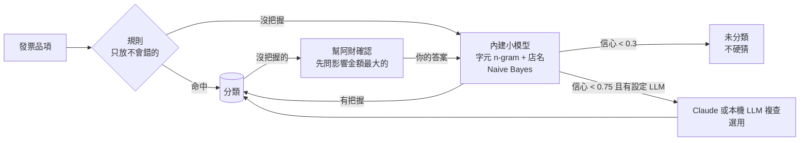
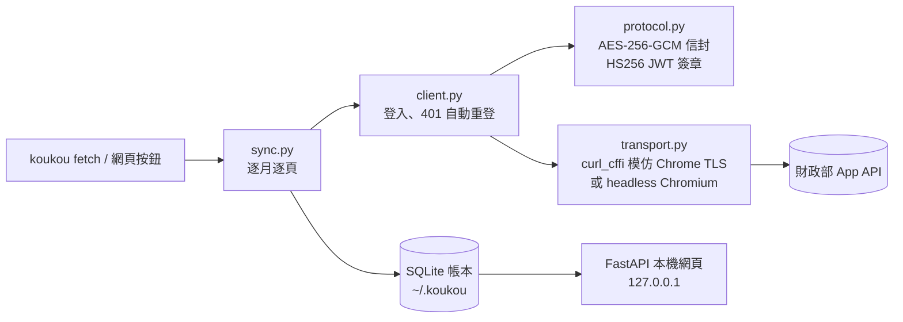

<div align="center">


# 摳摳 KouKou

**把散在各家銀行和發票載具裡的摳摳，一筆一筆摳回來。**<br>
*Dig your money data back out — and let AI tell you where it went.*

[](https://github.com/pengwho/koukou/actions/workflows/ci.yml)


**[👉 線上試玩 Live demo](https://pengwho.github.io/koukou/)**　·　[English](#english) · [中文](#中文)


</div>

## 中文

「摳摳」是台灣人講錢的口語。這個專案做三件事，剛好對上「摳」的三個意思：

| 摳 | 做什麼 |
| --- | --- |
| 摳摳＝錢 | 把手機條碼的電子發票（之後還有銀行帳戶）收進**你自己電腦上**的一本帳 |
| 摳＝挖出來 | 模擬官方 App 的協定把資料抓回來，不用一張一張手動匯出 |
| 摳＝省 | 助理**阿財**用內建的小模型幫每個品項分類，不用設定；沒把握的會問你，越用越準 |

### 先看看長什麼樣子

直接打開 **[線上展示](https://pengwho.github.io/koukou/)**，裡面是虛構的發票，什麼都不用裝。

### 用你自己的發票

```bash
pip install git+https://github.com/pengwho/koukou
koukou serve
```

瀏覽器會自動打開。第一次會請你輸入手機條碼的**手機號碼**和**驗證碼**（申請手機條碼時自己設定的那組，不是簡訊驗證碼），之後按「摳回最新發票」就會更新。

- 帳密存在系統鑰匙圈（macOS Keychain），不會寫進檔案；頁尾可以隨時「取消連結」
- 帳本在 `~/.koukou/koukou.sqlite3`；`koukou export` 匯出 CSV；`koukou fetch` 可從命令列同步
- `koukou demo` 用虛構資料在本機打開

### 阿財怎麼分類

**不用任何設定。** 摳回發票後，阿財會用內建的小模型把每個品項分好類：不用網路、不用 API 金鑰、不用另外裝軟體，三百種品名不到一秒。有沒把握的，它會在畫面上請你確認，你答一題，它就重新學一次，相似的品項跟著改。





- **內建小模型。** 純 Python 的 Naive Bayes：中文用字元片段、英文用整個單字、店名也是特徵（同樣的「月費」在健身房是娛樂）。訓練資料是 862 筆手寫標註的台灣發票品項（`koukou/ai/trainset.txt`），訓練不到 0.1 秒，所以每次分類前都把你的修正加進去重新訓練，不用存模型檔。
- **主動學習。** 「幫阿財確認」一次問一題，依影響金額排序。答案馬上變成訓練資料（權重 3 倍），相似品名跟著學會；在真實帳本上模擬，答 20 題後待確認清單從 51 個降到 28 個（多解決的 3 個是相似品名跟著學會的）。
- **不硬猜。** 信心低於 0.3 的標成「未分類」；0.3 到 0.6 的畫面上用虛線標出來，並列進確認清單。
- **LLM 是選配。** 有 Claude API 金鑰（`koukou ai setup`）或本機模型（`KOUKOU_AI_PROVIDER=openai KOUKOU_AI_MODEL=qwen2.5:7b`）的話，只把小模型沒把握的送去複查；LLM 有把握的答案也會回頭變成小模型的訓練資料。送出去的只有品名和店名，不送金額、日期、發票號碼或載具。
- **數字對得起來。** 折扣、點數折抵和發票差額依比例攤回同一張發票的其他品項，各分類加總等於當月發票總額。

```bash
koukou ai categorize   # 命令列分類（網頁上會自動做）
koukou ai eval         # 用保留測試集量準確率
koukou ai setup        # 選用：設定 Claude API 金鑰
```

#### 準確率

| 資料 | 規則 | 內建小模型 | 整體（不用任何金鑰） |
| --- | --- | --- | ---: |
| **保留測試集**：126 個人工標註品項，訓練時完全沒看過 | 覆蓋 19.8%，準確 100% | 準確 87.1% | **89.7%** |
| **作者真實帳本**：289 種品名，人工逐筆判斷 | 39 個，全對 | 250 個：對 196、錯 36、不猜 18 | **81%**（錯 12.5%、未分類 6%） |

真實帳本的數字比測試集低，這是預期中的事，也是這個專案最有價值的一課：

1. 第一版只在自己寫的測試集上量，看起來有 87%；拿真實帳本跑，只有約 66%。真實發票有大量英文品名（IKEA 的 `SWEDISH MEATBALLS`、`UPPSNOFSAD box`）、店內術語（壽司郎的「60元盤子」、「定食副餐」）、商品編號和聯名玩具，這些是手寫測試集沒涵蓋到的。
2. 依錯誤型態補了**通用**的訓練例子（不是把真實紀錄抄進來）、英文改用單字特徵、加上店名片段（「餐飲」「飲食店」），並讓模型沒把握時不猜：66% → 75% → 81%。
3. 規則層也是拿真實資料跑才發現「美式雞腿堡」被當成咖啡，修正後同類例子加進測試集當回歸測試。
4. 修正權重一開始太高（5 倍），導致改一個「750616@三商鮮五丼」，純數字的商品編號都被拉成餐飲；拿掉純數字特徵、降到 3 倍後副作用消失。

真實帳本的 81% 是看過這些錯誤之後改出來的，所以偏樂觀；保留測試集的 89.7% 才是乾淨的數字。真實資料的內容沒有放進這個 repo。

### 它怎麼運作



幾個值得一提的設計決定：

- **模擬手機 App，而不是爬網頁。** App 的 API 回傳結構化 JSON，有品項明細，也沒有圖形驗證碼。代價是要重現它的加密：登入資料用 AES-256-GCM 包成 `a|密文|b` 信封，查詢用登入拿到的密鑰簽 HS256 JWT。加密層有固定測試向量，跟參考實作逐位元比對。
- **兩種連線方式。** 財政部主機前面有 Cloudflare，一般的 HTTP client 會因為 TLS 指紋被擋。預設用 `curl_cffi` 模仿 Chrome 指紋（輕量，實測可通過）；被擋時可改用 `--transport browser` 在真的 Chromium 裡發請求，並在網路層拔掉查詢主機不接受的 `Origin` 標頭。
- **App 的 session 只有約 30 秒。** 抓半年資料一定會過期，所以遇到 `401` 就自動重新登入再重試。
- **增量同步。** 以發票號碼為主鍵覆寫；已經有品項的發票不會重抓，所以每天跑也很快。
- **本機服務也要防網頁攻擊。** 任何你打開的網站都能叫瀏覽器對 `127.0.0.1` 發請求。所以伺服器只接受 Host 是本機的請求（擋 DNS rebinding），會改變狀態的請求必須帶自訂標頭（跨站送不出來）。
- **線上展示不需要伺服器。** `koukou build-static` 把展示帳本匯出成一個 JSON，同一份前端在靜態模式下改從它讀資料、在瀏覽器裡搜尋；GitHub Actions 每次更新自動部署到 Pages。
- **展示模式走同一條路。** `koukou demo` 產生的假資料是 App API 的原始格式，經過跟真資料一樣的 `Store.save()`，所以它同時是寫入路徑的測試。

### 路線圖

- [x] 電子發票：表頭、品項、增量同步、CSV 匯出
- [x] 本機網頁介面與展示模式
- [x] 線上展示（GitHub Pages）、網頁上直接連結手機條碼、帳密存鑰匙圈
- [x] **阿財**：品項分類（規則＋內建小模型＋選用 LLM、主動學習、評估）
- [ ] **阿財**：用自然語言問帳本（text-to-SQL，唯讀與白名單防護）
- [ ] MCP server：讓 Claude 等 AI 直接查你的帳本
- [ ] 第一家銀行（Playwright）
- [ ] 打包成 macOS App，帳密改存 Keychain

### 注意

這是非官方工具，模擬官方 App 的做法不符合其使用條款；協定可能隨 App 改版失效。請只用在自己的帳號，資料只會存在你的電腦。

協定細節參考 [TedLin1993/all-set-tw](https://github.com/TedLin1993/all-set-tw)（MIT）。

---

## English

**KouKou** (摳摳, Taiwanese slang for *money*; 摳 also means *to dig out* and *to be thrifty*) is a local-first personal finance hub for Taiwan.

It pulls your e-invoices — every receipt tied to your mobile barcode carrier, down to line items — by speaking the official mobile app's API directly, stores them in a SQLite ledger on your own machine, and shows them in a small local web app. An assistant, **A-Tsâi (阿財, "little fortune")**, categorizes every line item with zero setup: high-precision rules, then a built-in pure-Python Naive Bayes model (Chinese character n-grams, English word features, store-name features) trained on 862 hand-labeled Taiwanese receipt items. It abstains when unsure, asks you about the uncertain items ranked by spending impact, and retrains instantly on each answer (active learning). An LLM (Claude or any OpenAI-compatible local model) is optional and only reviews low-confidence guesses. Offline accuracy: 89.7% on a held-out 126-item test set; ~81% on the author's real ledger (289 item names, judged by hand), up from ~66% for the first version after error analysis on real data. Bank accounts are next.

**[Try the live demo](https://pengwho.github.io/koukou/)** (generated data, nothing to install), or run it on your own invoices:

```bash
pip install git+https://github.com/pengwho/koukou
koukou serve           # opens http://127.0.0.1:8765 and asks for your carrier login on first run
```

Engineering notes: the app protocol wraps credentials in an AES-256-GCM envelope and signs queries as HS256 JWTs (covered by fixed test vectors); Cloudflare's TLS fingerprinting is handled with `curl_cffi` Chrome impersonation, with a headless-Chromium fallback that strips the `Origin` header at the network layer; the ~30-second app session is renewed transparently on `401`; syncs are incremental and idempotent; credentials live in the OS keychain; the local server rejects foreign Host headers and requires a custom header on state-changing requests to block DNS-rebinding and CSRF from other sites.

*Unofficial. Emulating the official app is against its terms of use and may break when the app updates. Use only with your own account.*

## License

MIT
